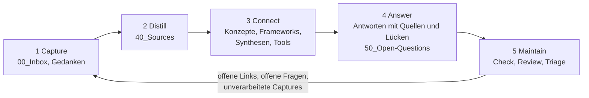

<!-- Deutsche Übersetzung, nicht massgebend. Massgebend ist die englische README.md. -->
# Zettelkasten-Hub

Ein kleines, werkzeugneutrales System für eine Wissensbasis, die **belegt antwortet, ihre Lücken kennt und mit anderen zusammen wachsen kann**. Einfache Markdown-Notizen, eine gemeinsame Regeldatei (`AGENTS.md`), fünf Phasen-Agenten mit dreizehn Verfahren, elf Vorlagen, drei Skripte. Keine Bindung an einen Anbieter: Es läuft mit jedem Agenten, der Dateien lesen kann, und mit Chat-Werkzeugen über eine gebündelte Datei.

> Stand: MVP 1, in Arbeit. Noch nicht von anderen Personen als dem Autor getestet.

## Wie es funktioniert
Wissen läuft durch eine Schleife aus fünf Phasen. Jede Phase hat einen Agenten: eine Markdown-Datei in [`agents/`](agents/) (deutsch: [`de/agents/`](de/agents/)), die sagt, wofür der Agent da ist, was er lesen und schreiben darf, welche Verfahren (Skills) er nutzt und welche Phase als Nächstes kommt. Jeder Agent liest zuerst die kurzen gemeinsamen Regeln in [`AGENTS.md`](AGENTS.md), dann seine eigene Datei, dann arbeitet er mit den Notizen in deinem Bundle.



| Phase | Agent | Was er tut | Schreibt | Skills |
|---|---|---|---|---|
| 1 Capture | [`capture`](agents/capture.md) | nimmt Links, Auszüge und eigene Ideen auf, ohne sie zu verarbeiten | `00_Inbox`, Gedanken in `10_Concepts` | capture-inbox, capture-thought, capture-zotero, find-existing |
| 2 Distill | [`distill`](agents/distill.md) | macht aus einer Quelle eine Source Note, Draft first | `40_Sources` | find-existing, draft-first, distill-source |
| 3 Connect | [`connect`](agents/connect.md) | Konzepte, Frameworks, Synthesen und Tools, mit begründeten Links | `10_Concepts`, `20_Frameworks`, `30_Syntheses`, `70_Tools` | find-existing, draft-first, write-concept, synthesize, write-tool |
| 4 Answer | [`answer`](agents/answer.md) | antwortet nur aus den Notizen, Herkunft pro Aussage, Lückenliste | `50_Open-Questions` (nur mit deiner Zustimmung) | answer-from-notes, record-open-question |
| 5 Maintain | [`maintain`](agents/maintain.md) | führt den Check aus, prüft Notizen, macht Lücken zu nächsten Eingaben | nur Korrekturen, nach Bestätigung | run-check, review-notes, triage-open-links |

Du wählst den Agenten; jeder schlägt am Ende den nächsten vor. Schreibende Agenten schlagen nach dem Speichern zudem Maintain vor. Jeder Agent hält seinen Kontext klein: gemeinsame Regeln, eigene Regeln und seine Skills, die kritischen Regeln am Anfang und am Ende wiederholt.

**Ein Durchlauf am Beispielbundle:** Ein Capture in [`example/00_Inbox`](example/00_Inbox/) zeigt auf eine Quelle, die noch eine Source Note braucht (Capture → Distill). Die Source Notes speisen ein Konzept und eine Synthese (Connect). Eine Frage an das Bundle wird daraus beantwortet, und eine Lücke aus der Antwort wird als [offene Frage](example/50_Open-Questions/wie-misst-man-weglassen.md) festgehalten (Answer). Maintain prüft das Bundle und gibt die offene Frage als nächste Suche an Capture zurück.

## Was du bekommst
| Schicht | Inhalt | Läuft mit |
|---|---|---|
| Daten | Markdown-Notizen in einem Bundle (`example/` zeigt eines) | überall |
| Regeln | [`AGENTS.md`](AGENTS.md): der gemeinsame Kern | Agenten, die Repo-Dateien lesen |
| Agenten | [`agents/`](agents/): eine Rolle pro Phase, dazu schlanke Adapter in `.github/agents/` (GitHub Copilot) und `.claude/agents/` (Claude Code) | jeder Agent: «folge agents/answer.md» |
| Verfahren | [`skills/`](skills/): vierzehn `SKILL.md`-Dateien als normale Markdown-Anleitung | von den Agenten genutzt; jeder Agent kann einem folgen |
| Prüfung und Bündeln | [`tools/check.py`](tools/check.py), [`tools/pack.py`](tools/pack.py), [`tools/catalog.py`](tools/catalog.py), nur Python-Standardbibliothek | von Hand, in CI |
| Zotero-Markierungen | [`tools/zotero_highlights.py`](tools/zotero_highlights.py): liest Markierungen aus einem laufenden Zotero (lesende lokale API) | der Agent Capture, nach Rückfrage |

## Gebaut auf Standards
Notizen sind Markdown mit YAML-Frontmatter und als Bundle nach dem [Open Knowledge Format](de/standards.md) organisiert (geprüft von `tools/check.py`); Regeln stehen in `AGENTS.md`; Agenten und Verfahren sind Markdown-Dateien; Versionierung läuft über Git. Einzelheiten und Abweichungen: [de/standards.md](de/standards.md). Wie die Teile zusammenspielen: [de/architecture.md](de/architecture.md).

## Notiz-Typen
Capture, Gedanke, Konzept, Framework, Synthese, Source (leicht oder vollständig), Tool, Offene Frage. Vorlagen in [`templates/`](templates/) (deutsch: [`de/templates/`](de/templates/)), dazu die Vorlage für Agenten-Dateien.

## Der 30-Minuten-Weg
Siehe die [Anleitung](de/guide.md) (deutsch) bzw. [guide](docs/guide.md) (massgebend, englisch). [Diagramme](docs/diagrams.md) zeigen Schichten, die Schleife und den Weg vom Klonen zur ersten Antwort.

## Am Beispiel ausprobieren
```
python tools/check.py example --example
python tools/pack.py example -k "addition bias" -a answer     # schreibt pack.md für Chat-Werkzeuge
```
Dann den Agenten `answer` wählen (oder deinem Agenten sagen: *«Folge agents/answer.md.»*) und fragen: *«Warum ergänzen Organisationen lieber, als wegzulassen?»*

## Agenten
- **Mit Dateizugriff** (Claude Code, Open-Source-CLIs wie Codex CLI oder OpenCode, GitHub Copilot im Agent-Modus): lesen `AGENTS.md`, die Agenten-Datei und ihre Skills direkt. GitHub Copilot und Claude Code listen die fünf Agenten über ihre Adapter; `.vscode/settings.json` zeigt VS Code den Ordner `skills/`. Andere Werkzeuge: die Agenten-Datei in der Anfrage nennen.
- **Chat ohne Repo-Zugriff** (zum Beispiel M365 Copilot): `pack.md` aus `pack.py -a <agent>` hochladen oder einfügen. Erwartung: etwas schwächere Qualität.
- Ob das trägt, steht ehrlich in [docs/acceptance.md](docs/acceptance.md).

## Sprache
Englisch ist Hauptsprache; deutsche Übersetzungen der Systemdokumente liegen unter `de/`. Notizen bleiben in der Sprache ihrer Quelle. Das Beispielbundle ist deutsch.

## Lizenz
Code in `tools/`: Apache 2.0 ([`LICENSE`](LICENSE)). Alle Texte, Vorlagen, Skills, Dokumentation und das Beispiel: CC BY 4.0 ([`LICENSE-CONTENT`](LICENSE-CONTENT)). Beispielnotizen: Daniel Boos; wo Claude den Ursprungstext verfasst hat, steht «DB+Claude».
