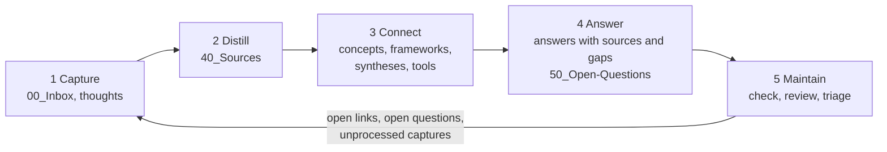

# Zettelkasten-Hub

A small, tool-neutral system for a knowledge base that **answers with sources, knows its gaps and can grow together with others**. Plain Markdown notes, one shared rules file (`AGENTS.md`), five phase agents with thirteen procedures, eleven templates, three scripts. No lock-in: it works with any agent that can read files, and with chat tools via a single bundled file.

> Status: MVP 1, work in progress. Not yet tested by people other than the author. German translation: [README.de.md](README.de.md).

## How it works
Knowledge moves through a loop of five phases. Each phase has one agent: a plain Markdown file in [`agents/`](agents/) that says what the agent is for, what it may read and write, which procedures (skills) it uses, and which phase comes next. Every agent first reads the short shared rules in [`AGENTS.md`](AGENTS.md), then its own file, then works on the notes in your bundle.



| Phase | Agent | What it does | Writes | Skills |
|---|---|---|---|---|
| 1 Capture | [`capture`](agents/capture.md) | takes in links, excerpts and your own ideas, without processing | `00_Inbox`, thoughts in `10_Concepts` | capture-inbox, capture-thought, find-existing |
| 2 Distill | [`distill`](agents/distill.md) | turns one source into a source note, draft first | `40_Sources` | find-existing, draft-first, distill-source |
| 3 Connect | [`connect`](agents/connect.md) | concepts, frameworks, syntheses and tools, linked with reasons | `10_Concepts`, `20_Frameworks`, `30_Syntheses`, `70_Tools` | find-existing, draft-first, write-concept, synthesize, write-tool |
| 4 Answer | [`answer`](agents/answer.md) | answers from the notes only, origin per statement, gap list | `50_Open-Questions` (only with your consent) | answer-from-notes, record-open-question |
| 5 Maintain | [`maintain`](agents/maintain.md) | runs the check, reviews notes, turns gaps into the next inputs | fixes only, after confirmation | run-check, review-notes, triage-open-links |

You pick the agent; each one ends by suggesting the next. Writing agents also suggest Maintain after saving. Each agent keeps its context small: the shared rules, its own rules and its skills, with the critical rules at the start and repeated at the end.

**One run, on the example bundle:** a capture in [`example/00_Inbox`](example/00_Inbox/) points to a source that still needs a source note (Capture → Distill). The source notes feed a concept and a synthesis (Connect). A question to the bundle is answered from them, and a gap the answer found is kept as [an open question](example/50_Open-Questions/wie-misst-man-weglassen.md) (Answer). Maintain checks the bundle and hands the open question back to Capture as the next thing to look for.

## What you get
| Layer | What | Works with |
|---|---|---|
| Data | Markdown notes in a bundle (`example/` shows one) | everything |
| Rules | [`AGENTS.md`](AGENTS.md): the shared core | agents that read repository files |
| Agents | [`agents/`](agents/): one role per phase, plus thin adapters in `.github/agents/` (GitHub Copilot) and `.claude/agents/` (Claude Code) | any agent: "follow agents/answer.md" |
| Procedures | [`skills/`](skills/): thirteen `SKILL.md` files in plain Markdown | used by the agents; any agent can follow one |
| Checks and bundling | [`tools/check.py`](tools/check.py), [`tools/pack.py`](tools/pack.py), [`tools/catalog.py`](tools/catalog.py), Python standard library only | by hand, in CI |

## Built on standards
Notes are Markdown with YAML frontmatter, organised as an [Open Knowledge Format](docs/standards.md) bundle (checked by `tools/check.py`); rules are in `AGENTS.md`; agents and procedures are Markdown files; versioning is Git. Details and where we deviate: [docs/standards.md](docs/standards.md). How the parts fit together: [docs/architecture.md](docs/architecture.md).

## Note types
Capture, Thought, Concept, Framework, Synthesis, Source (lightweight or full), Tool, Open question. Templates are in [`templates/`](templates/), together with the template for agent files.

## 30-minute path
Follow the [guide](docs/guide.md): clone, fill in `perspective.md`, write your first source note and concept, ask your first question, run the check. [Diagrams](docs/diagrams.md) show the layers, the loop and the way from clone to first answer.

## Try it on the example
```
python tools/check.py example --example
python tools/pack.py example -k "addition bias" -a answer     # writes pack.md for chat tools
```
Then pick the `answer` agent (or tell your agent *"Follow agents/answer.md."*) and ask: *"Why do organisations prefer adding to removing?"*

## Agents
- **With file access** (Claude Code, open-source CLIs such as Codex CLI or OpenCode, GitHub Copilot in agent mode): they read `AGENTS.md`, the agent file and its skills directly. GitHub Copilot and Claude Code list the five agents through their adapters; `.vscode/settings.json` points VS Code to `skills/`. Other tools: name the agent file in your request. `CLAUDE.md` only points to `AGENTS.md`.
- **Chat without repository access** (for example M365 Copilot): upload or paste `pack.md` made by `pack.py -a <agent>`. Expect somewhat weaker results; procedures arrive as text and instruction length is limited.
- Whether all of this holds up is checked in [docs/acceptance.md](docs/acceptance.md) and reported honestly there.

## Language
English is the main language; German translations of the system documents are in `de/` and `README.de.md`. Notes stay in the language of their source. The example bundle is German and exists once.

## License
Code in `tools/`: Apache 2.0 ([`LICENSE`](LICENSE)). All texts, templates, skills, documentation and the example bundle: CC BY 4.0 ([`LICENSE-CONTENT`](LICENSE-CONTENT)). Example notes are by Daniel Boos; where Claude wrote the original text this is stated as "DB+Claude".
