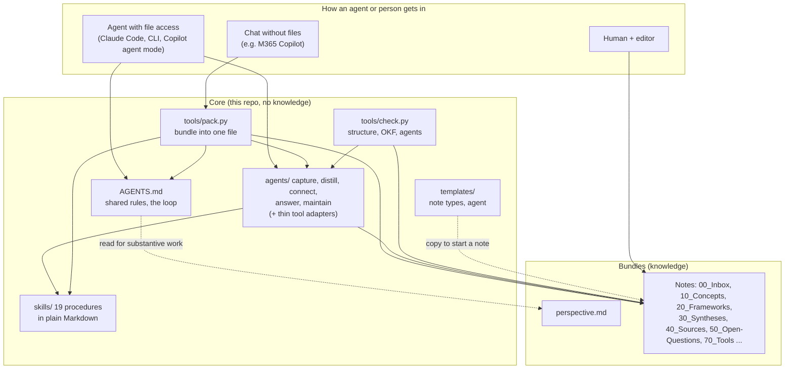
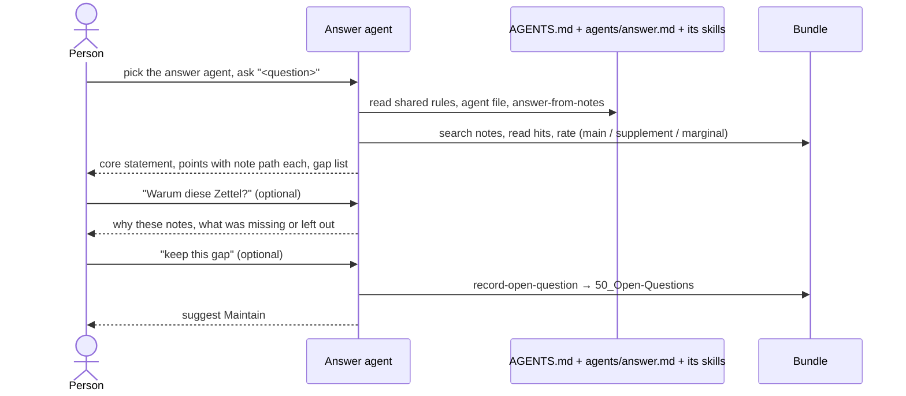

# Technical architecture

## 1. Goals and constraints
- **Answer with sources and know the gaps** (quality Q1), keep arguments precise (Q2), allow surprising connections (Q3, later), keep the base alive (Q4, later).
- **Agent-independent:** works with Claude Code, open-source CLIs, GitHub Copilot (agent mode), and via one uploaded file with chat tools such as M365 Copilot.
- **No lock-in:** plain files, open standards ([standards.md](standards.md)), Python standard library only, no service to run.
- **Knowledge stays separate from the system:** the core holds rules, agents, procedures, templates and tools; knowledge lives in bundles.
- **Small, focused context per step:** work is split into five phases with one agent each, so an agent loads only the shared core, its own rules and its skills, with the critical rules at the start and the end.
- Not goals of MVP 1: capture channels, MCP server, hosting, project module, a router agent that picks the phase.

## 2. Layers and components

Strict separation: **data** (Markdown) · **rules** (`AGENTS.md`) · **roles** (`agents/`) · **procedures** (`skills/`) · **checks and bundling** (scripts, no AI). Each layer can be replaced without touching the others.

## 3. Data model
**Bundle layout** (create only what you need): `00_Inbox`, `10_Concepts`, `20_Frameworks`, `30_Syntheses`, `40_Sources`, `50_Open-Questions`, `70_Tools`, `95_System`, plus `perspective.md` at the bundle root.

| Type | Folder | Template | Purpose |
|---|---|---|---|
| Capture | `00_Inbox` | `capture.md` | raw input, unprocessed; one line why it was kept |
| Thought | `10_Concepts` | `thought.md` | raw idea, original wording kept |
| Concept | `10_Concepts` | `concept.md` | one idea, 1–2 pages, the standard definition |
| Framework | `20_Frameworks` | `framework.md` | reusable way of thinking, 3–5 pages |
| Synthesis | `30_Syntheses` | `synthesis.md` | several sources in tension; divergences made visible |
| Source | `40_Sources` | `source-lightweight.md`, `source-full.md` | one per book, article or talk |
| Open question | `50_Open-Questions` | `open-question.md` | a gap found by an answer, kept on purpose |
| Tool | `70_Tools` | `tool.md` | usable checklist, format or method |

**Identity and links.** A note's identity is its path inside the bundle. Links are `[Title](/folder/file.md)`, always with a reason. Link direction runs only to the more general. Missing targets are legal (to-do list). A note carries `type:` (required), optional `aliases:` and `visibility:`.

**Authorship and trust.** The review block at the end of each note records created / last review / status, with initials per person; each agent signs with its own tag (`agent:capture`, `agent:distill`, …), so it stays visible which phase produced or last touched a note. Annotation markers separate the owner's note, a synthesis remark and an agent addition.

## 4. Components
**`AGENTS.md`**: the shared core every agent reads first: the never-break rules (at the top and again at the end), the loop and its agents, structure, note types, conventions, principles 1–2, confidentiality. About 50 lines. `CLAUDE.md` imports it.

**`agents/`**: one file per phase (`capture`, `distill`, `connect`, `answer`, `maintain`), built from `templates/agent.md`. Frontmatter: `type: Agent`, `name`, `description`, `phase`, `skills`, `reads`, `writes`. Sections: Role, Goal and when to use, Reads, Writes, Skills, Phase rules, Handoff, Final check. The phase-specific rules live here (for example draft-first in Distill and Connect, principles 3–5). The person picks the agent; each one suggests the next phase.

**Adapters**: `.github/agents/<name>.agent.md` (GitHub Copilot) and `.claude/agents/<name>.md` (Claude Code) hold only the tool's frontmatter and one line pointing to `AGENTS.md` and the neutral agent file. Their `tools:` are derived from the agent's write scope: all agents read, search and edit; only Maintain may run commands, and Capture may run `tools/zotero_highlights.py` and nothing else. Folder-level write limits cannot be enforced by these tools; they are declared in the agent file and checked in the acceptance test. `.vscode/settings.json` points VS Code to `skills/`.

**`skills/`**: nineteen procedures, named verb-object, shared where useful:
| Skill | Used by |
|---|---|
| `capture-inbox`, `capture-thought`, `capture-zotero` | Capture |
| `find-existing` | Capture, Distill, Connect |
| `draft-first` | Distill, Connect |
| `distill-source` | Distill |
| `write-concept`, `synthesize`, `write-tool` | Connect |
| `answer-from-notes`, `record-open-question` | Answer |
| `run-check`, `review-notes`, `triage-open-links` | Maintain |
| `map-frontier`, `discover-connections`, `inspire` | Explore |
| `challenge-position`, `revisit-notes` | Reflect |
They name no tool; an agent uses whatever search and file access it has. The exception is `capture-zotero`, which needs `tools/zotero_highlights.py`; without command access the person runs it and pastes the output.

**`tools/check.py`** (no AI, exit code 1 on errors):
| Rule | Level |
|---|---|
| frontmatter with non-empty `type:` on every `.md` except `index.md`/`log.md` (OKF conformance) | ERROR |
| file name lowercase-with-hyphens, no umlauts | ERROR |
| review status present (all note folders, including `00_Inbox` and `50_Open-Questions`) | ERROR |
| no wikilinks; links bundle-relative `/…md` | ERROR |
| link target missing | WARN (open link = to-do) |
| source-note name `lastname-year-…` | WARN |
| `--example`: no blockquotes (except the raw-idea section of thoughts), no `Loc.`/`S.` references, no links leaving the example except an allow-list, `visibility: public` | ERROR |
| `--i18n`: every German file names `translation_of:`, target exists, required system documents have a translation | ERROR |
| `--i18n` (repo check), agents: frontmatter fields, `name` = file name, `phase` 1–5, listed skills exist, `writes` are bundle folders, the eight sections, one adapter per tool and no adapter without an agent | ERROR |
| `--i18n` (repo check): a skill no agent uses | WARN |

**`tools/pack.py`** (no AI): selects notes by keyword score (title counts triple) or by file list, then writes one `pack.md`. With `-a <agent>`: preamble → `AGENTS.md` → the agent file → its skills in `skills:` order → bundle `perspective.md` → notes, each under its path as heading → the agent's final check again at the end, so the rules sit at the start and the end and the notes in the middle; notes are then chosen only from the agent's `reads:` folders. With `-s <skill>` (exclusive with `-a`): one procedure instead of an agent. Notes are copied verbatim. It prints the character count and warns above 30,000 characters.

**`tools/catalog.py`** (no AI): builds a thematic catalog of source notes from a manifest (one file per group, verbatim title, reference, core thesis and tags, each under its note path), for chat tools that need an overview of many sources. Used by the Answer agent without file access.

**`tools/zotero_highlights.py`** (no AI): reads highlights from a running Zotero desktop app through its read-only local API (`127.0.0.1:23119`, personal library only; Zotero setting «Allow other applications on this computer to communicate with Zotero»). `status` checks Zotero, `search` finds an item, `fetch` prints one Markdown block per item (exact text, page label, the owner's comment) with the highlights not yet imported, `mark-done` records them in the bundle's `.zotero-sync.json` (library version and imported annotation keys) after the notes are saved. Ink and image annotations are skipped. Used by the Capture agent through `capture-zotero`.

## 5. How a question is answered

Without file access: `python tools/pack.py <bundle> -k <keywords> -a answer`, then upload or paste `pack.md` instead of the first two arrows.

## 6. Several bundles (MVP 2, not built)
Own bundle and shared bundle side by side; a `bundles.md` file declares mount points and access (read / write). The checker will flag any link from a shared to an own bundle. Contributions flow upward by **promotion** (generalise, pseudonymise, move up; pull request or inbox file). A project module (manifest, hand-over package, promotion skill) builds on the same rules.

## 7. Visibility and safety
- `visibility:` per note (private | team | public); missing means private. Only `public` notes may be exported.
- Public bundles contain no verbatim book quotes; `check.py --example` enforces this for examples.
- Person names: source notes use real names, project notes a role or abbreviation.
- Scripts only read and write local files; they send nothing anywhere. `zotero_highlights.py` also reads from Zotero on the same machine (`127.0.0.1`), never from the internet.

## 8. Decisions and trade-offs
| Decision | Why | Cost |
|---|---|---|
| Markdown + frontmatter on the OKF model | portable, readable anywhere, tooling exists | few built-in fields; some conventions are ours |
| `AGENTS.md` as single shared rules file | works across agents | each agent follows rules with varying reliability |
| One agent per phase, skills as shared procedures | small focused context; rules near start and end; clear write scope per phase | more files; the person picks the agent (no router yet) |
| Neutral agent files + thin hand-written adapters | tool-neutral source, native agent lists in Copilot and Claude Code | adapters can drift; `check.py --i18n` catches missing and orphaned ones |
| Skills as plain Markdown | no loader needed | the agent has to read them; weaker in chat tools |
| Python standard library only | zero setup | no fancy parsing; frontmatter parser is deliberately simple |
| English authoritative, German translations of system documents | reach and clarity for agents | two versions to keep in sync; `--i18n` checks pairing only, not content |
| Bundle in the repo, example included | one clone to start | real knowledge belongs in your own repo |

## 9. Known limits
- Keyword selection in `pack.py` is simple (term counts, no stemming); use `-f` for exact control.
- `check.py` cannot judge quality, only structure; quality is the owner's and the agent's job.
- Write scopes are declared per agent; tools enforce only coarse limits (edit yes/no, commands yes/no), not folders.
- Chat tools truncate long input; expect weaker results through `pack.md`.
- No search index; fine for hundreds of notes, a hosted index is a later step.

## 10. Roadmap
MVP 1 (this repo): shared rules, five phase agents with adapters, fourteen skills, templates, four scripts, example. Then: two bundles together (MVP 2); project module; a router agent; capture channels; MCP server (read-only) and hosting; surprise impulses and review impulses.
