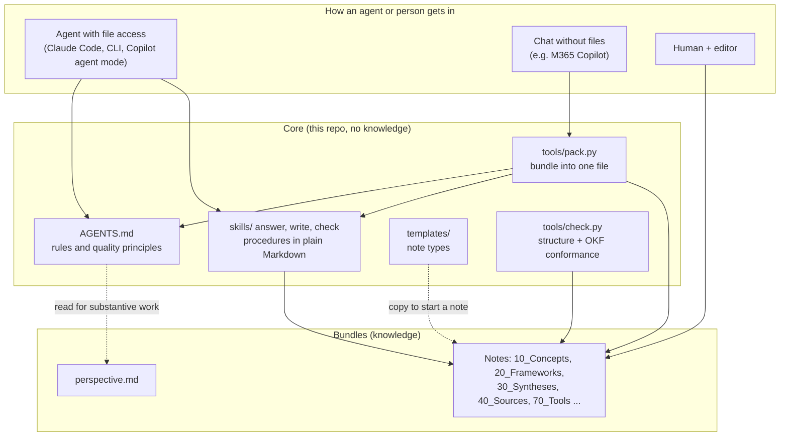
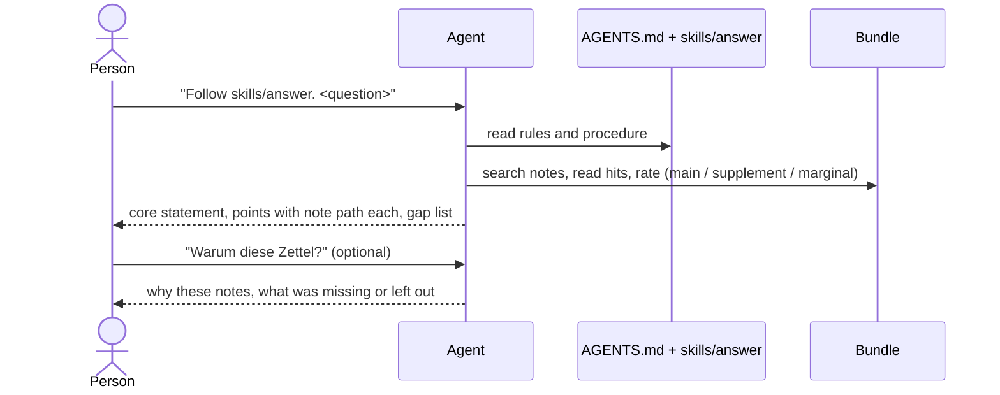

# Technical architecture

## 1. Goals and constraints
- **Answer with sources and know the gaps** (quality Q1), keep arguments precise (Q2), allow surprising connections (Q3, later), keep the base alive (Q4, later).
- **Agent-independent:** works with Claude Code, open-source CLIs, GitHub Copilot (agent mode), and via one uploaded file with chat tools such as M365 Copilot.
- **No lock-in:** plain files, open standards ([standards.md](standards.md)), Python standard library only, no service to run.
- **Knowledge stays separate from the system:** the core holds rules, templates, procedures and tools; knowledge lives in bundles.
- Not goals of MVP 1: capture channels, MCP server, hosting, project module.

## 2. Layers and components

Strict separation: **data** (Markdown) · **rules** (`AGENTS.md`) · **procedures** (`skills/`) · **checks and bundling** (scripts, no AI). Each layer can be replaced without touching the others.

## 3. Data model
**Bundle layout** (create only what you need): `00_Inbox`, `10_Concepts`, `20_Frameworks`, `30_Syntheses`, `40_Sources`, `50_Open-Questions`, `70_Tools`, `95_System`, plus `perspective.md` at the bundle root.

| Type | Folder | Template | Purpose |
|---|---|---|---|
| Thought | `10_Concepts` | `thought.md` | raw idea, original wording kept |
| Concept | `10_Concepts` | `concept.md` | one idea, 1–2 pages, the standard definition |
| Framework | `20_Frameworks` | `framework.md` | reusable way of thinking, 3–5 pages |
| Synthesis | `30_Syntheses` | `synthesis.md` | several sources in tension; divergences made visible |
| Source | `40_Sources` | `source-lightweight.md`, `source-full.md` | one per book, article or talk |
| Tool | `70_Tools` | `tool.md` | usable checklist, format or method |

**Identity and links.** A note's identity is its path inside the bundle. Links are `[Title](/folder/file.md)`, always with a reason. Link direction runs only to the more general. Missing targets are legal (to-do list). A note carries `type:` (required), optional `aliases:` and `visibility:`.

**Authorship and trust.** The review block at the end of each note records created / last review / status, with initials per person; agents use their own tag. Annotation markers separate the owner's note, a synthesis remark and an agent addition.

## 4. Components
**`AGENTS.md`**: the single source of conventions. Agents read it first. `CLAUDE.md` imports it.

**`skills/`**: `answer` (clarify, search, rate sources, answer with origin per statement and a gap list; selection reasoning only on request), `write` (draft-first creation of any note type), `check` (run the checker, explain, propose fixes). They name no tool; an agent uses whatever search and file access it has.

**`tools/check.py`** (no AI, exit code 1 on errors):
| Rule | Level |
|---|---|
| frontmatter with non-empty `type:` on every `.md` except `index.md`/`log.md` (OKF conformance) | ERROR |
| file name lowercase-with-hyphens, no umlauts | ERROR |
| review status present | ERROR |
| no wikilinks; links bundle-relative `/…md` | ERROR |
| link target missing | WARN (open link = to-do) |
| source-note name `lastname-year-…` | WARN |
| `--example`: no blockquotes (except the raw-idea section of thoughts), no `Loc.`/`S.` references, no links leaving the example except an allow-list, `visibility: public` | ERROR |
| `--i18n`: every German file names `translation_of:`, target exists, required system documents have a translation | ERROR |

**`tools/pack.py`** (no AI): selects notes by keyword score (title counts triple) or by file list, then writes one `pack.md`: preamble → `AGENTS.md` → bundle `perspective.md` → chosen skill → notes, each under its path as heading so that the origin can be named. Notes are copied verbatim. It prints the character count and warns above 30,000 characters.

## 5. How a question is answered

Without file access: `python tools/pack.py <bundle> -k <keywords> -s answer`, then upload or paste `pack.md` instead of the first two arrows.

## 6. Several bundles (MVP 2, not built)
Own bundle and shared bundle side by side; a `bundles.md` file declares mount points and access (read / write). The checker will flag any link from a shared to an own bundle. Contributions flow upward by **promotion** (generalise, pseudonymise, move up; pull request or inbox file). A project module (manifest, hand-over package, promotion skill) builds on the same rules.

## 7. Visibility and safety
- `visibility:` per note (private | team | public); missing means private. Only `public` notes may be exported.
- Public bundles contain no verbatim book quotes; `check.py --example` enforces this for examples.
- Person names: source notes use real names, project notes a role or abbreviation.
- Scripts only read and write local files; they send nothing anywhere.

## 8. Decisions and trade-offs
| Decision | Why | Cost |
|---|---|---|
| Markdown + frontmatter on the OKF model | portable, readable anywhere, tooling exists | few built-in fields; some conventions are ours |
| `AGENTS.md` as single rules file | works across agents | each agent follows rules with varying reliability |
| Skills as plain Markdown | no loader needed | the agent has to read them; weaker in chat tools |
| Python standard library only | zero setup | no fancy parsing; frontmatter parser is deliberately simple |
| English authoritative, German translations of system documents | reach and clarity for agents | two versions to keep in sync; `--i18n` checks pairing only, not content |
| Bundle in the repo, example included | one clone to start | real knowledge belongs in your own repo |

## 9. Known limits
- Keyword selection in `pack.py` is simple (term counts, no stemming); use `-f` for exact control.
- `check.py` cannot judge quality, only structure; quality is the owner's and the agent's job.
- Chat tools truncate long input; expect weaker results through `pack.md`.
- No search index; fine for hundreds of notes, a hosted index is a later step.

## 10. Roadmap
MVP 1 (this repo): rules, templates, three skills, two scripts, example. Then: two bundles together (MVP 2); project module; capture channels; MCP server (read-only) and hosting; surprise impulses and review impulses.
