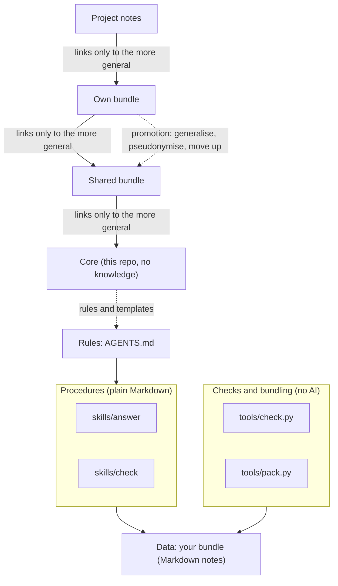
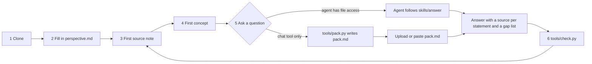

# Diagrams

## 1. Layers and the link rule

Links point only to the more general. The way back is promotion.

## 2. From clone to first answer

More diagrams (components, how a question is answered) are in [architecture.md](architecture.md).
