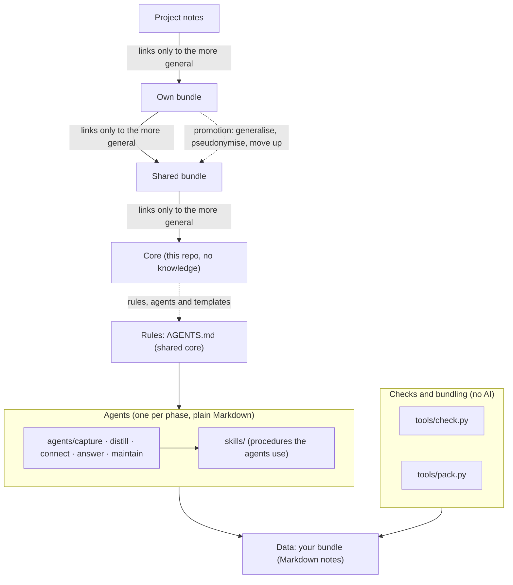
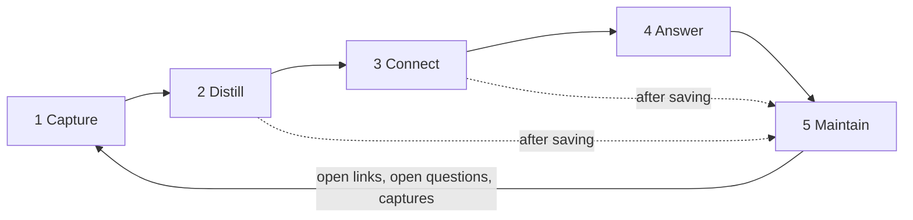
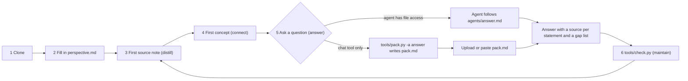

# Diagrams

## 1. Layers and the link rule

Links point only to the more general. The way back is promotion.

## 2. The loop

One agent per phase; the person picks it, and each agent suggests the next. Writing agents also suggest Maintain after saving (dotted). What each agent reads, writes and uses: [README, How it works](../README.md#how-it-works).

## 3. From clone to first answer

More diagrams (components, how a question is answered) are in [architecture.md](architecture.md).
